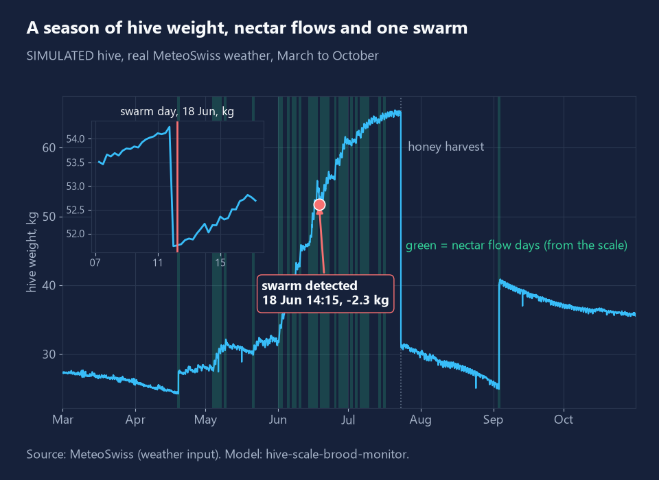
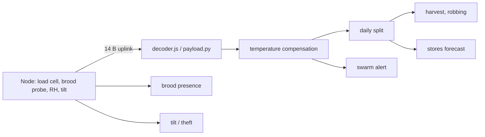

# hive-scale-brood-monitor

Open-source smart beehive monitor for Swiss beekeepers: hive scale, brood-nest temperature, humidity and a tilt sensor in one 14-byte uplink, plus the analytics that turn them into swarm, nectar-flow, harvest and winter-stores alerts.



Full result figure: [docs/figure.png](docs/figure.png). The hive in the picture above is **simulated** (real MeteoSwiss weather, modelled colony).

About 17,500 beekeepers keep about 165,000 colonies in Switzerland (Agroscope, see Data sources). Most check a hive by opening it.

## What it does

- **Daily weight split** into nectar intake, consumption and evaporation (night loss beyond the quiet-night baseline).
- **Swarm alert**: a 0.9-3.5 kg drop that happens within two hours on a warm midday, persists for two samples, and is not a handling event (accelerometer shock / service mode).
- **Honey-harvest readiness**: enough gain, flow over, night evaporation finished.
- **Winter stores forecast**: days of stores left at the current consumption rate (straight line; see limits).
- **Brood presence** from brood-nest temperature stability (regulated nests sit near 34-35 C and barely move; Kleinhenz et al. 2003, J Exp Biol, doi 10.1242/jeb.00680, report 33-36 C), plus a brood-break alert (queen-loss hint).
- **Theft / tipping alarm** from tilt and shock, with a mute for service mode.
- **Robbing hint** from consecutive net daytime losses (weak, see results).
- **Device side**: 14-byte payload ([hivemon/payload.py](hivemon/payload.py)), JavaScript decoder ([decoder/decoder.js](decoder/decoder.js), LoRaWAN `decodeUplink` style), air-time and battery estimate, load-cell temperature compensation ([docs/LOADCELL.md](docs/LOADCELL.md)).

## Results

Produced by `python -m hivemon demo` (48 simulated hive-years: Zurich, Bern, Engelberg weather, 2023 and 2024, seed 7; thresholds were chosen on a different seed). Full output in [docs/results.md](docs/results.md) and [docs/results.json](docs/results.json).

| Measurement | Result | Data |
|---|---|---|
| Swarm alert | precision 0.84, recall 0.91, median delay 15 min (p90 30 min), 23 swarms of 1-3 kg | simulated |
| Swarm alert | 2 of 2 beekeeper-logged swarms alerted (drops of 2.5 and 3.0 kg) | real, 54 hives, DK/PT, 2019-2020 |
| Other alerts, real | 564 alerts not on a logged handling day in about 60 hive-seasons; unlabelled, many are probably unlogged handling or feeding | real |
| Alerts per hive-season | 0.69 (swarm 0.52, tilt/theft 0.17) | simulated |
| Daily nectar estimate | MAE 0.24 kg/day (0.60 on flow days), r = 0.91 | simulated |
| Load-cell compensation | p90 error 0.184 to 0.191 kg in this final run; about 17 % better in an 8-hive check (noisy) | simulated |
| Harvest readiness | day accuracy 0.85, precision 0.83, recall 0.62 | simulated |
| 30-day weight forecast | MAE 0.74 kg (bias +0.11), n = 168 | simulated |
| 30-day weight forecast | MAE 2.58 kg (bias -0.21), n = 13 forecasts on 10 hives | real, autumn 2019 |
| Brood presence | day accuracy 0.87, precision 1.00, recall 0.81 | simulated |
| Queenless brood-break alert | 6 of 6 hives, median 21 days after queen loss (brood must run out first) | simulated |
| Theft / tipping | recall 1.00 (6 events), 3 false alarms in 48 hive-years | simulated |
| Robbing hint | recall 0.25 (1 of 4), 0 false alerts | simulated |
| Queen presence from sound | hive-held-out balanced accuracy 0.27, below chance: **does not transfer between hives, not shipped** | real audio, 2 hives |
| Battery (assumed currents) | 15-min uplinks: 7.7 years at SF7, 2.4 years at SF12; 60-min: 11.9 / 6.5 years | calculation |

Real brood-nest temperature (two Brazilian hives, no inspection labels): median daily means 34.6 C and 36.2 C with daily standard deviations of 0.25 and 0.14 C, so the stability criterion flags them as brood hives (100 % and 80 % of days). Without inspections this is a plausibility check, not an accuracy.

## Quick start

```bash
pip install -e ".[dev]"
python -m hivemon demo                 # about 4 minutes: simulate, evaluate, write docs/results.* and figures
python -m hivemon demo --no-figures --per-cell 2   # quick
python -m hivemon decode 1012d90d80fec07b0000a0000000             # decode a hex payload
node decoder/test.js                   # JS decoder against Python-encoded vectors
python -m pytest -q
```

## How it works



The simulator ([docs/SIMULATOR.md](docs/SIMULATOR.md)) runs a colony model on 15-minute MeteoSwiss weather and returns the device view plus hidden truth and labelled events (swarm, robbing, queen loss, theft, tipping, inspection, harvest, feeding). Analytics never read the truth columns.

## Data sources

- Weather: MeteoSwiss, SwissMetNet hourly open data (Zurich / Fluntern, Bern / Zollikofen, Engelberg), data.geo.admin.ch. Source: MeteoSwiss.
- Real hive-scale weight and beekeeper log: "Research project on field data collection for honey bee colony model evaluation - datasets", Zenodo, doi 10.5281/zenodo.5148318, CC BY 4.0 (hourly weight of 54 colonies, Denmark and Portugal, 2019-2020; derived table committed).
- Real brood-nest temperature, humidity, weight: "Hive Monitoring (Apis mellifera and Stingless Bees) and Rainfall Data - Federal University of Ceara (UFC) Apiary - Brazil", Zenodo, doi 10.5281/zenodo.20399470, CC BY 4.0.
- Hive audio: "To bee or not to bee: An annotated dataset for beehive sound recognition", Zenodo, doi 10.5281/zenodo.1321278, CC BY 4.0 (only band-power features are committed).
- Swiss beekeeper numbers: Agroscope, "Bienenhaltung in der Schweiz", https://www.agroscope.admin.ch/de/bienenhaltung-in-der-schweiz (about 17,500 beekeepers, about 165,000 colonies).

Details and the data set that was left out for licence reasons: [docs/DATA.md](docs/DATA.md).

## What is not verified yet

- No Swiss hive, no real brood-temperature data with inspection labels, no real node was used. Brood accuracy is simulated only.
- The simulator is my own model. Swarm precision and recall depend on how it generates handling and noise; real apiaries will differ. Thresholds were tuned on simulated data.
- Real swarm check: only two logged swarms, in one hive. The 564 other real alerts are unlabelled; the beekeeper log is day-level and not a ground truth for every event.
- The shock/service-mode suppression is untested on real hardware; a swarm may also shake the hive.
- Stores forecast is a straight line. It misses the consumption rise when brood rearing restarts and is wrong when feeding or harvesting happens.
- Load-cell compensation gain is small and noisy; bench-measure the coefficient if you can.
- Robbing hint is weak (1 of 4). Queen presence from sound did not transfer between the two hives available, so it is not in the device logic ([hivemon/acoustics.py](hivemon/acoustics.py) holds the experiment).
- Battery life uses assumed currents, not measurements. Payload size and air time are calculated, not tested on a gateway.
- Not a veterinary or disease tool; no varroa detection.

## Licence

MIT, Copyright (c) 2026 Victor Bonilla. Data sets keep their own licences (see above).
